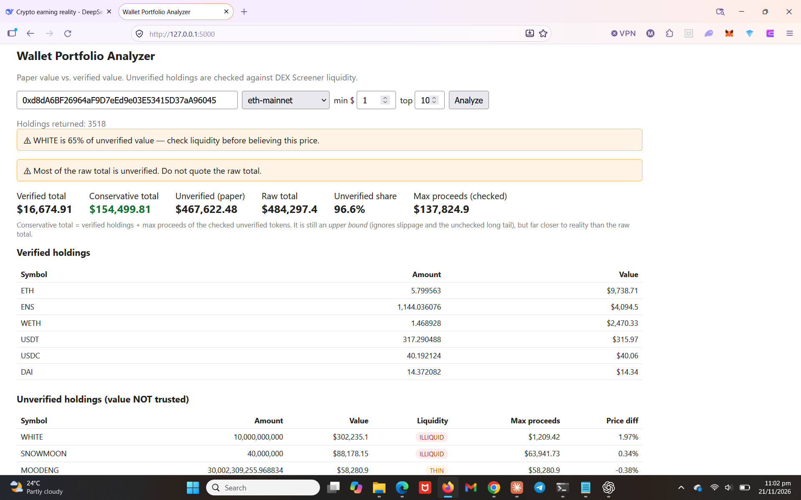

# On-Chain Wallet Analysis

A small Python tool that fetches a wallet's token balances from the
[GoldRush API](https://goldrush.dev) and separates **trustworthy** value from
**unreliable** value.

## The problem

Price feeds will happily assign a dollar value to almost any token, including
airdropped junk and tokens traded in tiny, illiquid pools. Summing those values
gives a portfolio total that looks real but isn't.

## What I found

I ran the tool on a well-known public Ethereum wallet
(`0xd8dA6BF26964aF9D7eEd9e03E53415D37aA96045`), November 2026 snapshot:

| Metric | Value |
|---|---|
| Holdings returned (`no-spam=true`) | 3,514 |
| Verified total | $17,863.00 |
| Unverified total | $494,743.06 |
| Raw total (what a naive sum shows) | $512,606.06 |
| Unverified share of raw total | 96.5% |
| Holdings with a balance but no price | 2,479 |

- **Spam filtering works but is not enough.** An unfiltered request returned
  9,054 holdings ($573,297.63); `no-spam=true` removed 5,541 flagged tokens.
- **Three tokens that passed the filter (WHITE, SNOWMOON, MOODENG) make up about
  $476k, roughly 93% of the raw total.** None is flagged as spam, but their
  prices come from thin markets and could not realistically be realized.
  WHITE alone is 66% of the unverified value.
- **Prices of these tokens are unstable.** Between two runs, SNOWMOON moved from
  about $80.9k to $88.5k while ETH barely moved.
- **Symbols are not identities.** Several tickers (ETH, DAI, FOLD...) appear
  multiple times as different contracts, so tokens are matched by contract
  address, never by symbol.
- **The native gas token needs special handling.** GoldRush identifies it by a
  placeholder address, and my first version misclassified the wallet's ETH as
  unverified until I tested against real data.

Prices and balances change; re-run the tool for current numbers.

## Stage 2: can the value actually be realized?

A price multiplied by a balance is not a sale price. For the top 10 unverified
holdings I looked up each token's DEX pools and capped the sellable value at
half the pool liquidity (only the quote side of a pool can be drawn out).
A later snapshot of the same wallet:

| Token | Feed value | Pool liquidity | Max proceeds (ceiling) | Status |
|---|---|---|---|---|
| WHITE | $327,430 | $2,255 | $1,127 | ILLIQUID |
| SNOWMOON | $85,570 | $130,217 | $65,109 | ILLIQUID |
| MOODENG | $57,694 | $307,254 | $57,694 | THIN |
| FOLD | $7,679 | $1,329,982 | $7,679 | OK |
| OMG | $4,977 | $3,799 | $1,900 | ILLIQUID |

(Top 10 checked in total; 5 shown. FOXE had no pool found on DEX Screener.)

- **Across the 10 checked tokens, feed value was $487,618 but the ceiling on
  proceeds was $137,078, about 72% lower.**
- **WHITE's $327k feed value sits on a pool holding about $2.3k.** The price
  may be correct for one token and meaningless for ten billion.
- The ceiling ignores slippage (the slippage model below estimates it), so real proceeds would be lower still,
  especially for SNOWMOON and MOODENG, where the position is large relative
  to the pool.
- "NO_POOL" means DEX Screener found no pair, not that no market exists.

## Stage 3: what would a sale actually fetch?

The "max proceeds" ceiling says what a pool could pay at most. A real sale pushes
the price down as it executes (slippage), so `--liquidity` now also estimates the
proceeds of selling the whole position.

**Method** (in [`slippage.py`](slippage.py)):

- Each pool is treated as constant-product (x * y = k). Its two sides are worth the
  same in USD, so the reserves follow from the pool's liquidity and price.
- A trading fee (default 0.3%, change it with `--fee-pct`) is taken from the sale.
- The sale is split into small chunks, each routed to the pool that pays the most at
  that moment, so several pools share it.
- Pools labelled v3, v4 or concentrated-liquidity are excluded, because their real
  depth near the current price differs from their total liquidity. The tool reports
  how much of a token's pool liquidity the model covers, and marks an estimate with
  `*` when that is under half.
- Not modelled: price moves during the sale, MEV, exchange or bridge liquidity,
  multi-hop routes. It is an estimate, not a quote.

The model is checked against the toy pool in the field guide (1,000 tokens and
$1,000 returns $90.91, $500.00 and $909.09 for sales of 100, 1,000 and 10,000
tokens) in `tests/test_slippage.py`:

```bash
python -m unittest discover -s tests
```

## Web version

A browser-based version of the analyzer lives in [`web/`](web/). It shows the
same verified vs. unverified split and liquidity check in a single page.
See [web/README.md](web/README.md) for setup.



## How it works

1. Fetch balances (`balances_v2`) with `no-spam=true`.
2. Convert raw integer balances: `amount = balance / 10^decimals`.
3. Classify each holding:
   - **Verified**: native gas token, or contract address on an allowlist
   - **Unverified**: everything else (value reported, not trusted)
4. Print totals, concentration warnings, and optionally export to CSV.
5. With `--liquidity`: look up the top unverified holdings on DEX Screener and
   compare each holding's feed value with what its trading pools could absorb.

## Usage

```bash
pip install -r requirements.txt

# Windows (cmd)
set GOLDRUSH_API_KEY=your_key_here
# macOS / Linux
export GOLDRUSH_API_KEY=your_key_here

python goldrush_portfolio.py --wallet 0xYourWalletAddress --csv holdings.csv

# add the liquidity check (uses DEX Screener, no extra key needed)
python goldrush_portfolio.py --wallet 0xYourWalletAddress --liquidity --top 10
```

Your API key is read from an environment variable and is never stored in the code.

## Limitations

- If GoldRush returns holdings with no prices (a pricing outage), the tool stops
  with an error instead of printing $0 totals. A missing price is never treated as zero.
- The allowlist is small and covers Ethereum mainnet only.
- A token being off the allowlist does not mean it is fake; it means its value
  is unverified.
- Prices come from a third-party feed and can be wrong or manipulated.
- This is an analysis tool, not financial advice.

## Roadmap

- [x] Liquidity checks for unverified tokens
- [x] Slippage model (estimate proceeds from pool reserves, not just a ceiling)
- [ ] Transaction history analysis
- [ ] Equivalent analysis in SQL on Dune Analytics
- [ ] Multi-chain support

## License

MIT
