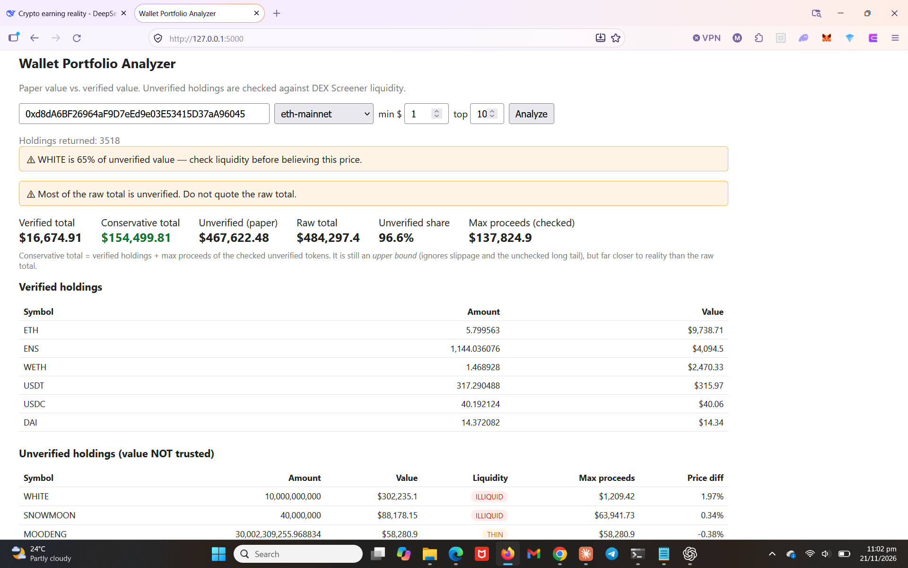

# Wallet Portfolio Analyzer (Web Version)

A local web tool that separates **trusted** wallet value from **paper** value.



## The problem

Naive portfolio viewers multiply token balance by a price feed and show a total.
That total is often fiction: a wallet can display $484,000 while most of it sits in
illiquid tokens that could never be sold anywhere near the quoted price. This tool
exposes that gap instead of hiding it.

## What it does

- Fetches all token balances for a wallet via the GoldRush (Covalent) API.
- Splits holdings into **verified** (native gas token + an allowlist of well-known
  contracts like WETH, USDC, USDT, DAI, WBTC, ENS, stETH, LINK, UNI, AAVE) and
  **unverified** (everything else: value reported but not trusted).
- For the top unverified holdings, queries DEX Screener (free, no key) for actual
  pool liquidity, and computes an **upper bound on what could be sold**.
- Reports the **raw total**, the **upper-bound total** (verified value plus the
  sellable ceiling of the checked tokens) and the **verified total**.
- Warns when one token dominates the unverified value, or when most of the raw
  total is unverified.

## What it does NOT do

- It does not tell you what to buy or sell.
- It does not promise any outcome.
- It does not account for slippage. The "max proceeds" figure is already an
  upper bound; real proceeds would be lower.
- It does not cover the long tail of tokens below the value threshold.

This is a **decision-support tool**. DYOR still applies.

## How to run

```bash
pip install -r requirements.txt

# Windows (cmd)
set GOLDRUSH_API_KEY=your_key_here
# macOS / Linux
export GOLDRUSH_API_KEY=your_key_here

python app.py
```

Then open http://127.0.0.1:5000 in your browser.

## Example result

Snapshot for a well-known public wallet (live data, so numbers change on every run):

| Metric | Value |
|---|---|
| Raw total | $484,297 |
| Upper-bound total | $154,500 |
| Verified total | $16,675 |
| Unverified share | 96.6% |

The largest holding, WHITE, shows a paper value of $302,235 but is flagged
ILLIQUID with a max proceeds ceiling of ~$1,209. Without the liquidity check,
that single token would make the wallet look ~$300k richer than it is.

## Technical notes

- If GoldRush returns holdings with no prices (a pricing outage), the page shows an
  error instead of $0 totals, and unpriced rows show "n/a". A missing price is never treated as zero.
- Backend: Python + Flask. Frontend: a single HTML page served by Flask.
- Data sources: GoldRush (balances + prices), DEX Screener (pool liquidity).
- The API key is read from the environment variable `GOLDRUSH_API_KEY` and is
  never sent to the browser.
- Inputs are validated (wallet format, supported chains, capped `top`), and all
  token-supplied text is HTML-escaped before display, because token names and
  symbols are chosen by whoever created the token.
- The server binds to `127.0.0.1` and has no login: run it locally only.
- Verified allowlist is per-chain; extend `ALLOWLIST_ETH` for your own use case.

## Known limitations

- The allowlist covers Ethereum mainnet only; on other chains only the native
  token counts as verified.
- The core logic is duplicated from the command-line version in the parent
  folder. A planned refactor will share one module between both.
